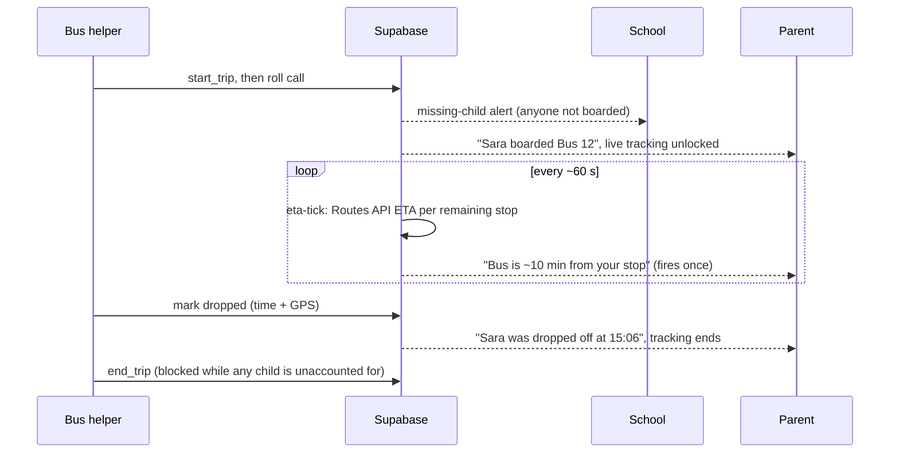

# School Bus Safety Tracker

**A verified record of every child's bus journey, with live alerts for schools and parents.** It's built for the UAE market and runs in Arabic (RTL) and English from day one.

The school knows who got on. Parents know when their child boarded, where the bus is, when it's ten minutes from their stop, and when their child was dropped off.

| | |
| --- | --- |
| **Mobile** | Expo 57 / React Native 0.86, expo-router, react-native-maps. One app with *Helper* and *Parent* modes |
| **Web** | Next.js 16 + next-intl. Landing page and school admin dashboard |
| **Backend** | Supabase: Postgres, Row-Level Security, RPCs, Edge Functions, pg_cron |
| **Maps / ETA** | Google Maps Platform Routes API: traffic-aware, multi-waypoint ETAs |
| **Tooling** | pnpm monorepo, TypeScript, Vitest, pgTAP database tests, GitHub Actions CI |

---

## Who uses it

| Role | Where | What they do |
| --- | --- | --- |
| **School admin** | Web dashboard | Manage students, guardians, buses, routes and stops; get missing-child alerts; watch every bus live |
| **Bus helper** | Mobile, Helper mode | Start a trip, take roll call, tick children off at each stop. Their phone is the bus's GPS source |
| **Parent** | Mobile, Parent mode | Get boarded / approaching / dropped pushes, track the bus *only while their child is on it*, pre-report absences |

## The trip flow



The morning trip runs the same model in reverse: pickup at stops, drop-off at school.

## Engineering highlights

- **Security in the database.** Every table has RLS, and 40 ordered migrations define the schema, RLS helpers and trip-action RPCs. A parent can read the bus location only while their own child is on board.
- **Notifications that fire exactly once.** A transactional `notification_outbox` with dedupe keys (for example `eta10:{trip}:{student}`) means retries never double-notify. Pushes from helper taps wait 10 seconds so a mis-tap can be undone.
- **Server-side ETA.** The `eta-tick` Edge Function makes one Routes API call per active trip with all remaining stops as waypoints. Alerts work even when the parent app is closed.
- **Watchdogs** on pg_cron raise one deduplicated alert for a bus that has gone silent (lost contact), a bus that hasn't moved, and an overdue trip. Forcing a trip to end with children unaccounted for raises a high-priority alert.
- **Many-to-many families.** Siblings and multiple guardians are handled, and one person can hold several roles (a helper who's also a parent) with a role switcher.
- **Tested at the SQL layer.** 25 pgTAP suites cover RLS, roll call, drop-off, morning trips, absences, the outbox, ETA application, watchdogs, data purging and security.
- **GPS replay tool** (`pnpm gps:replay`) feeds a recorded route in as fake pings, so ETA logic can be tested without driving.

## Repository layout

```
apps/
  mobile/        Expo app (helper + parent modes)
  web/           Next.js landing page + school dashboard
packages/
  shared/        generated DB types, shared logic
  i18n/          Arabic + English strings
supabase/
  migrations/    schema, RLS, RPCs (40 migrations)
  functions/     eta-tick, notify-dispatch, push-receipts
  tests/         pgTAP suites
tools/           i18n sync, GPS replay
docs/contracts/  exact names for tables, RPCs, routes, i18n keys
tasks/           phased task breakdown + STATUS.md
```

## Running locally

```bash
pnpm install
pnpm db:reset          # start local Supabase and apply migrations + seed
pnpm db:test           # pgTAP suites
pnpm test              # Vitest
pnpm gen:types         # regenerate packages/shared DB types
```

See `apps/mobile` and `apps/web` for the app-specific dev commands and `.env.example` files.

## Status

Phases 0–5 are built: database, apps, trip flow, push and live tracking, ETA alerts, watchdogs and hardening. **Phase 6 (pilot and store launch)** is in progress. What's left is device ride-along testing, production deployment, and store submission. See [`IMPLEMENTATION_PLAN.md`](IMPLEMENTATION_PLAN.md) for the full design and [`tasks/STATUS.md`](tasks/STATUS.md) for progress.
